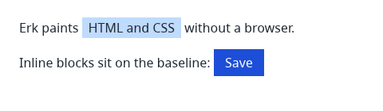

# Erk Engine

```
┌──────────────────────────────────────────────────────┐
│                      ERK ENGINE                      │
│                                                      │
│   HTML/CSS → desktop UI, drawn by Erk itself         │
│   Rust · MIT OR Apache-2.0 · no WebView · no JS core │
└──────────────────────────────────────────────────────┘
```

**Erk** is an embeddable HTML/CSS UI engine for desktop applications, written
in Rust. Your application owns the logic and drives the document; Erk styles
it, lays it out, paints it and reports what the user did. The goal is the
space Sciter has proven, as an open-source engine built on standard CSS.



*Rendered by Erk, not a browser: `cargo run -p erk-renderer --example png`.*

> **Erk is early.** It renders pages to a window or a PNG, reacts to input
> (pointer, wheel, keys), and can be embedded from Rust or C: load a page,
> find nodes, build and change the document (one call at a time or in
> batches), subscribe to events. A TodoMVC with its host in Rust runs on it
> (`cargo run -p erk --example todomvc`). It renders incrementally: a change
> restyles, lays out and repaints only what it touches. Text fields
> (`input`, `textarea`) are drawn and editable, with a blinking caret;
> selection, the clipboard, IME and the other form controls are still to
> come (M5). See [current limitations](#current-limitations).

## The Vision: Built for Embedded Systems & the AI Era

Modern UI frameworks often bundle an entire web browser just to draw a simple interface. This bloat is incompatible with the next generation of hardware and software development. Erk Engine is built with a clear vision for the future:

- **Targeting Embedded and Low-RAM Devices:** Industrial panels, medical devices, kiosks, and Raspberry Pis are short on memory, and a WebView or a JavaScript engine brings a browser's worth of it. By leaving JavaScript out and rendering standard HTML/CSS directly from Rust, Erk aims at smooth, native-speed UIs on constrained hardware. Measured today on a desktop CPU: scrolling a 10,000-card page takes at most 7.3 ms a frame (p95), one changed text among 10,000 elements about 19 ms, and a text field's blinking caret about 4 ms, because a change restyles, lays out and repaints only what it touches. Memory is the open front: a small page takes 23.7 MB of private memory and a 10,000-element page about 470 MB, so a memory diet (M5.13) comes before M5 is done. Erk has not been measured on embedded hardware yet (see [Measurements](#measurements)). It is an alternative to expensive or complex C++ GUI libraries, with its own API (Rust and a C ABI), not a drop-in replacement.
- **The Perfect Architecture for AI-Assisted Coding:** As LLMs write more of our code, they often hallucinate or fail when tangled in npm packages, bundler configs, and complex JavaScript framework lifecycles. However, AI is exceptionally good at writing standard HTML/CSS and pure system code (Rust/C/Go). Erk's zero-boilerplate architecture—separating a "dumb" HTML/CSS UI from a compiled, native backend—provides the most deterministic, AI-friendly environment for rapid app generation.
- **A Return to Sanity (Dumb UI, Smart Core):** We reject the trend of forcing system logic, state, and routing into the view layer. In Erk, the interface is just markup and styling. The intelligence lives where it belongs: in your compiled, I/O-capable system code, running without IPC bridges or garbage collection pauses.

## Why Erk?

- **No WebView, no JavaScript engine, ever.** Erk is the renderer: the
  same page draws the same pixels on every machine, and `<script>` in HTML
  is never run. Content cannot execute code.
- **Your language drives the UI.** Rust and a C ABI today; Python, Go and
  JavaScript/TypeScript (Node.js and Bun) are planned, every one of them
  through the C ABI. JavaScript drives Erk from outside, like any other
  host language. The host addresses the document by opaque node ids and sends
  batched changes; Erk sends back events.
- **A core that cannot reach your system.** The engine core does no file,
  network or process I/O and reads no clock or environment variable.
  Resources and time come from the host. CI enforces this.
- **Standard CSS, measured.** A clearly bounded subset of CSS, styled by
  Stylo (Firefox's style engine). What is supported, planned or never
  planned is listed in [docs/css-support.md](docs/css-support.md), every
  supported row names its test, and every reference page is compared with
  Chrome pixel by pixel and box by box.
- **Built on mature Rust components**, with original work where none of
  them reach: html5ever, Stylo, Taffy, Parley and Vello; Erk's own inline
  layout, embedding API, incremental rendering and form controls.

## How Erk compares

Each of these is a good tool; they make different trade-offs.

| | Erk | Tauri | Sciter | Blitz |
|---|---|---|---|---|
| Renderer | Its own: Stylo, Taffy, Parley, Vello | The operating system's WebView (WebView2, WKWebView, WebKitGTK) | Its own, in C++ | Its own: Stylo, Taffy, Parley, Vello |
| Scripting | None, ever; `<script>` is never run | JavaScript (any web framework) | Built in (JavaScript) | None; driven from Rust (Dioxus) |
| Host languages | Rust, C ABI; Python, Go, JavaScript/TypeScript (Node.js, Bun) planned | Rust backend, web frontend | C API, many bindings | Rust |
| CSS | Standard, a documented subset | The WebView's full web platform | Standard CSS plus its own extensions | Standard |
| Same pixels on every OS | Yes (embedded fonts, one CPU renderer) | No: each WebView renders differently | Own renderer; graphics backend varies by platform | Own renderer |
| Licence | MIT OR Apache-2.0 | MIT OR Apache-2.0 | Proprietary | MIT OR Apache-2.0 |
| Maturity | Early | Production | Production | Pre-release |

- **Choose Tauri** to build the UI with the web ecosystem (React, Vue, npm)
  and accept the platform WebView.
- **Choose Sciter** if you need a mature embedded HTML engine today.
- **Choose Blitz** to write the UI in Rust with Dioxus.
- **Erk is for** an HTML/CSS interface driven from Rust, C, Python, Go or
  JavaScript/TypeScript,
  without a WebView or a JavaScript stack: installers, launchers, tray and
  settings panels, internal tools, industrial panels. Once it is ready.

Erk shares Blitz's foundation and adapts parts of its code (MIT OR
Apache-2.0); the differences are the embedding contract, the host-driven
API and the I/O-free core.

## Architecture

```
host application (Rust; C, Python, Go planned)   logic, state, files
        │   ▲
        │   │  node ids, batched mutations, events
        ▼   │
erk (Rust API) ── erk-ffi (C ABI, erk.h)
        │
engine core: erk-dom · erk-style · erk-renderer   no I/O, no clock
        │
window: winit + softbuffer
```

The document lives on the UI thread; rasterizing runs on its own thread and
receives a plain-data display list. Details: [ARCHITECTURE.md](ARCHITECTURE.md)
and the embedding contract, [p1-contract.md](docs/design/p1-contract.md)
(Turkish).

## Example

A host loads a page, finds a node, subscribes to clicks on it and changes
the page from the callback
([`crates/erk/examples/hello.rs`](crates/erk/examples/hello.rs)):

```rust
use erk::{App, Config, EventKind};

let mut app = App::new(Config { title: "Hello".to_owned(), ..Config::default() })?;
app.load_html(r#"<button id="b">Click</button><p id="label">Not yet.</p>"#);
let button = app.query(None, "#b")?.expect("the page has a button");
let label = app.query(None, "#label")?.expect("the page has a label");
app.on(button, EventKind::Click, move |cx, _event| {
    cx.set_text(label, "Clicked.").unwrap();
})?;
app.run()?;
```

The same from C, through `include/erk.h`
([`examples/c/hello.c`](examples/c/hello.c)):

```c
ErkApp *app;
erk_app_create(&config, &app);
erk_load_html(app, page);
erk_query(app, ERK_NODE_NONE, selector, &button);
erk_on(app, button, ERK_EVENT_CLICK, on_click, user_data, on_destroy, &subscription);
erk_app_run(app);
erk_app_destroy(app);
```

Both examples also run without a window (`App::headless`,
`ERK_APP_HEADLESS`), clicking the button themselves; CI runs them on
Linux, Windows and macOS.

```sh
cargo run -p erk --example hello              # without a window
cargo run -p erk --example hello -- --window  # in a window
cargo run -p erk-shell -- examples/m2-demo.html
```

## Current limitations

Today Erk does **not**:

- show form controls other than text fields (`select`, checkboxes, radio
  buttons, `button` as a native control), select text in a field, copy and
  paste, or take IME input (M5);
- decode images other than PNG and JPEG, or load stylesheets and fonts
  from the host (later);
- draw dotted, dashed or double borders (drawn solid), or inset shadows;
- take a paragraph's direction from CSS `direction`: right-to-left text
  is drawn, but a paragraph's direction comes from its first letter;
- keep its memory small on large pages: about 15 KB an element today
  (M5.13 measures where it goes and cuts it).

Never planned: floats, table layout, multi-column, print, `<script>` and
any browser-compatible JavaScript environment. The full list is in
[docs/css-support.md](docs/css-support.md).

## Measurements

Measured, not claimed. Windows 11, Intel i7-10750H, release build, CPU
rendering (`vello_cpu`) at 800 × 600 unless the row says otherwise; frame
times are from the benchmark (`cargo run --release -p erk --example bench`),
every frame checked against a full recompute in the tests:

| What | Result |
|---|---|
| Scrolling a 10,000-card page (B15) | 7.3 ms a frame at p95, within 120 Hz; 709 ms before incremental rendering. On the GPU (GTX 1650) the raster takes 1.5–4.6 ms |
| One text changes among 10,000 elements (B1) | 18.6 ms median a frame; 454 ms at p95 before M5 |
| A text field's caret blinks on a 5000-element page (B17) | 3.8 ms median, 4.7 ms p95: no styling, no layout, only the changed tiles repainted |
| Repaint after a change | only the 32 px tiles that changed: about 2 ms of raster for one changed text |
| Private memory | 23.7 MB for a small page (`examples/m2-demo.html`), 472 MB for 10,000 elements (about 15 KB an element); the GPU path takes more. M5.13 cuts it |
| Release binary, default profile (Windows) | 16.2 MB (measured at M3; the Linux binary is held under a 34.2 MB budget in CI) |

The [Web Platform Tests](https://web-platform-tests.org/) reftests run in
CI against a recorded baseline: 69.4 % of `css/CSS2/normal-flow` (518 of
746), 59.5 % of `css/css-flexbox` (602 of 1012), 24.3 % of `css/css-text`
(362 of 1489) and 20.3 % of `css/css-position` (51 of 251) pass today. Most
failing tests use something Erk does not support yet (external stylesheets,
web fonts, block-in-inline) or never will (tables, floats, script). A result
that falls needs a written reason. Fuzz jobs feed the renderer random pages
and the API random sequences of host calls on every change, and check every
frame against the page recomputed from nothing.

The Linux release binary is held under a size budget in CI. Similarity to
Chrome 155 on the reference pages: every element box matches within 1 CSS
pixel on all 24 pages, and pixel scores range from 48 % on text-heavy
pages (glyph antialiasing differs) to 100 % on boxes; the scores are in
[expectations.txt](crates/erk-renderer/tests/reference/expectations.txt)
and may only rise unless a written reason says otherwise.

## Roadmap

| Milestone | Scope | Status |
|---|---|---|
| M0 | First pixel | Done |
| M0.5 | The embedding contract | Done |
| M1 | Static UI: inline layout, flexbox, positioning, borders, images, system fonts | Done |
| M2 | Input, hit testing, scrolling, GPU rendering; the counter demo | Done |
| M3 | Rust API and C ABI | Done |
| M4 | Mutable DOM and events, gradients, 2D transforms; TodoMVC | Done |
| M5 | Incremental rendering, forms, IME, accessibility | In progress: incremental rendering done (M5.0–M5.6); focus, cancellable defaults and form values (M5.7); text fields underway (M5.8: drawn, editable, blinking caret); then selection and IME, the other controls, accessibility, transitions and a memory diet |
| M6 | Bindings: Python, Go, JavaScript/TypeScript (Node.js, Bun) | Planned |
| M7 | Developer tools, written with Erk | Planned |
| M8 | Packaging, ABI 1.0 | Planned |
| M9–M12 | Compositor, host GPU surfaces, SVG and media, components | Planned |

Every milestone ends with something demonstrable and an acceptance test; the
project gives no dates. Full roadmap: [roadmap.md](docs/plans/roadmap.md)
(Turkish).

## Design philosophy

- **A rule not enforced by CI does not exist.** Architectural rules (no
  `unsafe` outside named crates, no I/O in the core, plain-data messages
  between threads) are checked by guard scripts, each tried against a
  deliberate violation.
- **Tests, not eyes.** Rendering is checked by golden images and by
  comparison with Chrome; a test must break when what it protects breaks.
- **Measure before promising.** Size, memory and frame-time numbers come
  from measurements on a named machine, never from targets.
- **A subset, not a dialect.** Erk leaves out parts of CSS, but what it
  supports behaves as the standard says.

## Building

Requirements:

- A recent stable [Rust toolchain](https://rustup.rs/); the exact version is
  pinned in `rust-toolchain.toml`
- On Windows: the MSVC Build Tools with the C++ workload
- Python 3 (used by Stylo's build script)

```sh
cargo build
cargo test
```

Open a local HTML file in a window, or paint it to a PNG:

```sh
cargo run -p erk-shell -- examples/merhaba.html
cargo run -p erk-shell -- --screenshot out.png examples/merhaba.html
```

The window draws on the GPU (wgpu and vello_hybrid) when the machine can,
and says so on stderr; `--cpu` draws with vello_cpu instead. Screenshots,
golden images and the reference tests always use vello_cpu.

## Project layout

```
crates/
  erk/           the Rust API: an app, its document, its raster (M3)
  erk-ffi/       the C ABI (include/erk.h), which every other language binds
  erk-shell/     window, event loop, the demo host
  erk-renderer/  the engine (layout, display list) and the raster
  erk-style/     CSS styling with Stylo
  erk-invalidation/ what changed since the last frame, and what it makes dirty
  erk-dom/       arena DOM and HTML parsing
  erk-wpt/       runs the Web Platform Tests reftests against the baseline
docs/
  design/        architecture decisions (Turkish)
  plans/         roadmap and milestone plans (Turkish)
  css-support.md what CSS works, is planned, or is not planned
```

## Contributing

Contributions are welcome! Please read [CONTRIBUTING.md](CONTRIBUTING.md) and our
[Code of Conduct](CODE_OF_CONDUCT.md) first.

## License

Erk Engine is dual-licensed under either:

* MIT License ([LICENSE-MIT](LICENSE-MIT) or http://opensource.org/licenses/MIT)
* Apache License, Version 2.0 ([LICENSE-APACHE](LICENSE-APACHE) or http://www.apache.org/licenses/LICENSE-2.0)

at your option.

The embedded Noto Sans font files in `crates/erk-renderer/assets/fonts` are
licensed under the [SIL Open Font License 1.1](crates/erk-renderer/assets/fonts/OFL.txt).

### Contribution

Unless you explicitly state otherwise, any contribution intentionally submitted
for inclusion in the work by you, as defined in the Apache-2.0 license, shall be
dual licensed as above, without any additional terms or conditions.
